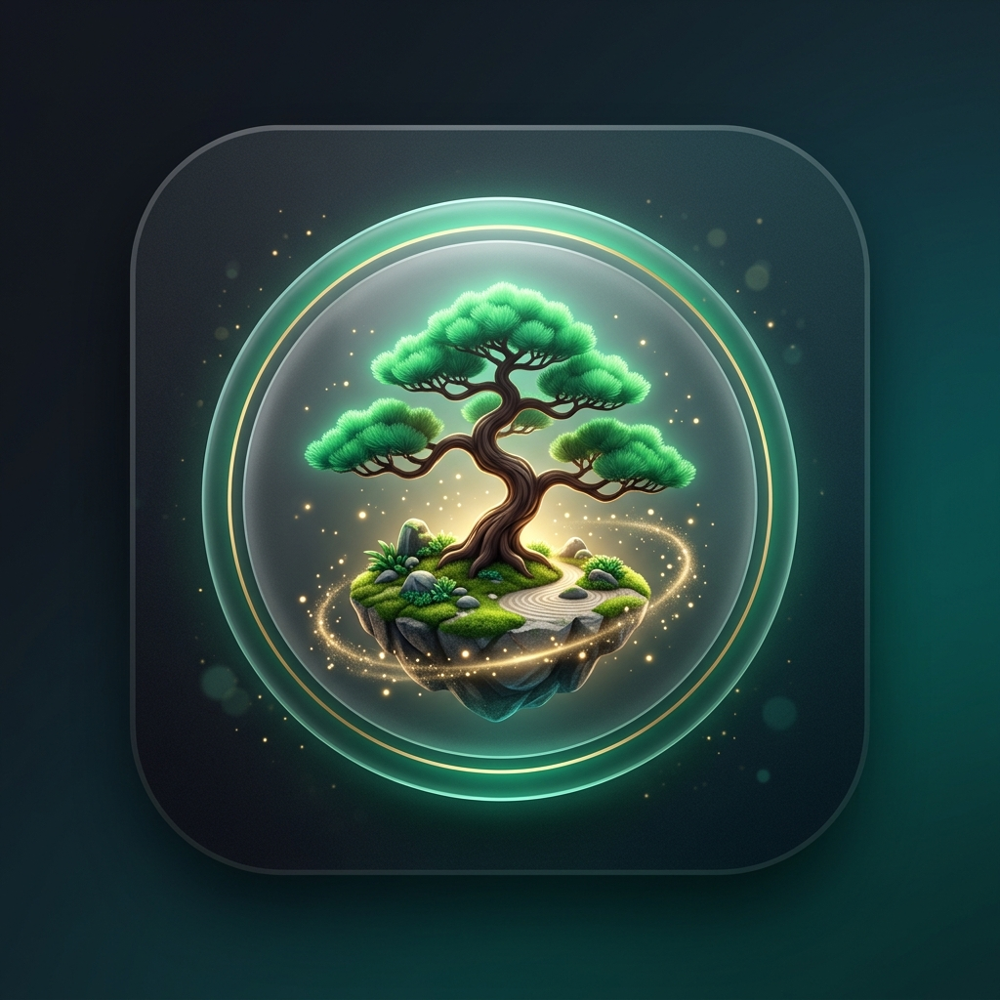

# 🌿 واحة التركيز • Focus Oasis

<p align="center">
  
</p>

<p align="center">
  <b>تطبيق إدارة الوقت والإنتاجية بتقنية بومودورو مع نظام تلعيب زراعة الأشجار ومزامنة سحابية لحظية متعددة المنصات</b><br/>
  <i>Smart Pomodoro Timer & Gamified Virtual Forest Sanctuary with Realtime Cloud Sync</i>
</p>

<p align="center">
  
  
  
  
  
</p>

---

## 🌟 المميزات الرئيسية • Key Features

- **⏱️ محرك بومودورو ذكي (Smart Pomodoro Engine):**
  - أوضاع مخصصة: جلسة تركيز (25 د)، استراحة قصيرة (5 د)، استراحة طويلة (15 د) قابلة للتعديل بحرية.
  - حلقة تقدم دائرية متحركة فائقة الجمال مع تأثير الشفق الزمردي.
  - وسوم وتصنيفات للمهام (`Work`, `Study`, `Coding`, `Reading`, `Art`).

- **🌳 تلعيب واحة الغابة (Forest Gamification & Oasis Grid):**
  - تزرع بذرة تنمو وتزدهر مع كل دقيقة تركيز وتصبح شجرة كاملة عند إكمال الجلسة.
  - عقوبة الاستسلام: إذا استسلمت في منتصف الجلسة، تذبل الشجرة في حديقتك.
  - متجر مشتل الأشجار (`Tree Nursery Store`): أكثر من 10 أنواع من الأشجار النادرة (شجرة الساكورا، الأرز اللبناني، الصنوبر، البامبو، شجرة البلور الكونية) يمكنك فتحها بالعملات المكتسبة.

- **🌐 دعم متعدد اللغات كامل (Full Multilingual Support):**
  - دعم كامل للغة العربية (RTL)، الإنجليزية (LTR)، الفرنسية (Français)، والإسبانية (Español).
  - تبديل فوري للغة دون الحاجة لإعادة تشغيل التطبيق.

- **🏆 مجتمع الواحة، التحديات ولوحة الصدارة (Community & Challenges):**
  - لوحة شرف تفاعلية للمتصدرين مصنفة حسب اليوم، الأسبوع، وكل الأوقات.
  - بث حي للطلاب والزملاء المتصلين في نفس اللحظة مع إمكانية إرسال تشجيعات (`Send Cheers`).
  - مهام وتحديات إنتاجية يومية وأسبوعية بمكافآت وجوائز قيمة.

- **☁️ مزامنة سحابية لحظية متعددة الأجهزة (Realtime Cloud Sync via Supabase):**
  - مزامنة الجلسات، الأشجار المزروعة، والمهام عبر الجوال والويب وسطح المكتب.
  - بث حالة المؤقت لحظياً بين الأجهزة المختلفة عبر قنوات Supabase Realtime.

- **🎧 أصوات محيطية واسترخاء (Ambient Sounds & Breathing):**
  - مولد نغمات صوتية أوفلاين مدمج (Pure 528Hz Zen Chime، Warm Brown Noise).
  - أصوات المطر، أمواج البحر، وتغريد العصافير.
  - جلسة تنفس وتأمل موجهة بتقنية 4-7-8 خلال الاستراحات.

- **🖥️ وضع النافذة العائمة المصغرة (PiP / Mini Mode):**
  - تحويل الواجهة لنافذة صغيرة دائمة الظهور في أعلى الشاشة لمتابعة الوقت أثناء العمل.

---

## 🚀 تشغيل وبناء التطبيق • Running & Building

### المتطلبات الأساسية (Prerequisites)
- [Flutter SDK](https://docs.flutter.dev/get-started/install) الإصدار 3.22 فما فوق.
- متصفح Google Chrome (لتشغيل الويب) أو نظام Windows / Android SDK.

### تشغيل التطبيق محلياً:
```bash
# تثبيت الحزم والمكتبات
flutter pub get

# تشغيل التطبيق على المتصفح
flutter run -d chrome

# تشغيل التطبيق على نظام ويندوز
flutter run -d windows
```

### بناء حزم الإنتاج (Building for Production):
```bash
# بناء نسخة الويب (Web Build)
flutter build web --release

# بناء حزمة أندرويد APK (Android APK)
flutter build apk --release

# بناء نسخة ويندوز (Windows Desktop Executable)
flutter build windows --release
```

---

## 🏪 المتاجر والمنصات المجانية للنشر • Free Stores & Hosting

يمكنك نشر وتوزيع **واحة التركيز** على أفضل المنصات والمتاجر **المجانية 100% بدون أي رسوم اشتراك**:

### 1. موقع ويب مباشر مجاني (GitHub Pages & Vercel)
- **GitHub Pages:**
  1. قم ببناء نسخة الويب: `flutter build web --release --base-href "/Focus-Oasis/"`
  2. ارفع محتويات مجلد `build/web` إلى فرع `gh-pages`.
  3. سيصبح تطبيقك متاحاً للعالم فوراً على رابط: `https://username.github.io/Focus-Oasis/`.
- **Vercel / Netlify:**
  - اربط مستودع GitHub بحساب Vercel أو Netlify المجاني، واضبط مجلد الإخراج على `build/web` ليعمل في ثوانٍ مع دومين مجاني ودعم HTTPS تلقائي.

### 2. متجر Itch.io (متجر تطبيقات وألعاب مجاني 100%)
- منصة [Itch.io](https://itch.io/) مجانية تماماً ولا تتطلب أي رسوم تسجيل مطورين.
- تدعم تشغيل الويب مباشرة في المتصفح (`HTML5 Game/App`)، أو رفع ملفات تحميل مضغوطة لنظام Windows (`.zip`) وتطبيق أندرويد (`.apk`).

### 3. توزيع مباشر عبر GitHub Releases (مجاني 100%)
- في صفحة مستودع GitHub الخاص بك، توجه إلى قسم **Releases** -> **Create a new release**.
- ارفع ملف الـ APK الناتج من `build/app/outputs/flutter-apk/app-release.apk` وملف الـ Windows المضغوط.
- يحصل المستخدمون على روابط تحميل مباشرة سريعة ومجانية دائماً.

### 4. متجر F-Droid و IzzyOnDroid (لمستخدمي أندرويد مفتوح المصدر)
- [IzzyOnDroid](https://apt.izzysoft.de/fdroid/) و [F-Droid](https://f-droid.org/) هما متجران مجانيان بالكامل لمستخدمي أندرويد لتطبيقات المصدر المفتوح، حيث يمكنك إضافة تطبيقك ليقوم المستخدمون بتحميله وتحديثه تلقائياً.

---

## 🗄️ إعداد قاعدة بيانات Supabase (خطوة واحدة سهلة)

إذا كنت ترغب بربط مشروعك الخاص على Supabase:
1. أنشئ حساباً مجانياً على [Supabase.com](https://supabase.com).
2. أنشئ مشروعاً جديداً (`New Project`).
3. توجه إلى **SQL Editor**، وافتح ملف [`supabase_schema.sql`](supabase_schema.sql) وانسخ محتواه واضغط **Run**.
4. انسخ رابط المشروع (`Project URL`) والـ `anon public key` من لوحة التحكم وضعهما في نافذة إعدادات المزامنة بالتطبيق.

---

## 📄 الترخيص • License

هذا المشروع مرخص بموجب رخصة [MIT](LICENSE) - يمكنك استخدامه، تعديله، وتوزيعه بحرية تامة.
